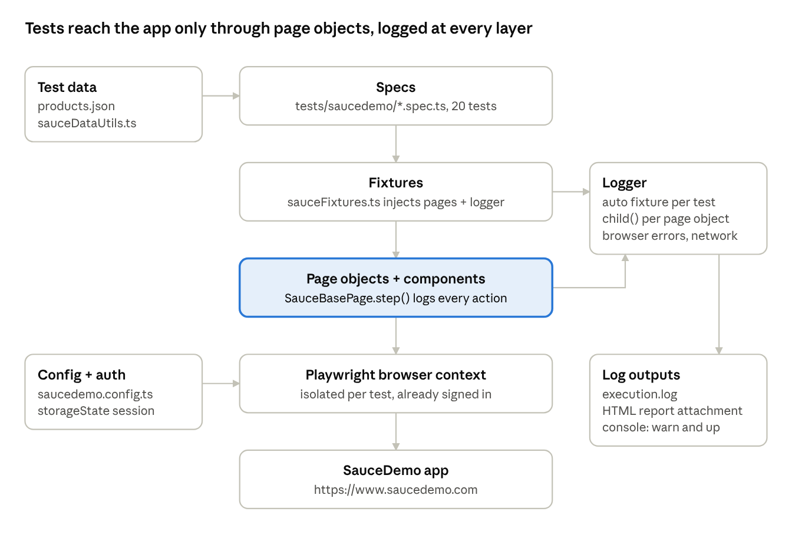

# SauceDemo Automation Framework Guide

Last updated: Oct 31, 2026 · Prasad Devathi

## Overview

The SauceDemo module is a runnable Playwright + TypeScript UI test suite of 20 tests. It runs against the public practice store [SauceDemo](https://www.saucedemo.com) and needs no secrets or setup beyond `npm install`. It lives inside the `playwright-automation` framework and follows the same conventions as the rest of the repo.

It is built on five industry-standard practices:

- **Page Object Model (POM)**: each screen of the app is one class that owns its locators and actions. Tests describe *what* the user does, and page objects own *how*.
- **Fixtures**: page objects are injected into tests by Playwright fixtures, so no test calls `new SomePage(page)`.
- **Login once, reuse the session**: a setup project logs in one time and saves the session (`storageState`). Every test then starts already signed in.
- **Structured logging**: every test and every page action is logged with timestamps, levels and durations. Each test's log is attached to its HTML report entry.
- **Data kept out of tests**: the expected product catalog is a JSON file, and customer details are generated with faker.

A test flows through the layers top-down. The **spec** asks for fixtures. **Fixtures** build page objects and the logger. **Page objects** drive the browser through Playwright and log each step. **Config and test data** feed every layer.



A spec never touches the browser directly: fixtures build page objects, and page objects drive Playwright. The logger is attached at the fixture and page-object layers, so every action is recorded without any code in the specs.

## Prerequisites and setup

You need Node.js 18 or newer (verified on Node 24.21) and internet access to `www.saucedemo.com`. Setup is four commands, run once. The project root is the cloned folder (on this PC, the `playwright-automation` folder).

```bash
git clone https://github.com/prasaddevathi/playwright_automation.git
cd playwright_automation
npm ci                                   # Playwright, TypeScript, faker, ESLint, Prettier (exact locked versions)
npx playwright install chromium          # browser binary (add --with-deps on Linux)
```

A `.env` file is **optional** for SauceDemo, because every value has a working default. Create one only to change logging levels or point at another copy of the app:

```bash
cp .env.example .env
```

| Variable | Default | Purpose |
| --- | --- | --- |
| `SAUCE_BASE_URL` | `https://www.saucedemo.com` | App URL under test |
| `SAUCE_STANDARD_USER` | `standard_user` | User for the shared login session |
| `SAUCE_PASSWORD` | `secret_sauce` | Password for all SauceDemo users |
| `LOG_LEVEL` | `debug` | Lowest level written to log files and report attachments |
| `LOG_CONSOLE_LEVEL` | `warn` | Lowest level echoed to the terminal |

The file is git-ignored, so real values never get committed. Only the `.env*.example` templates are tracked.

## Step-by-step walkthrough

Follow these 14 steps in order the first time. Steps 1–5 are one-time setup, steps 6–10 are the daily local loop, and steps 11–14 run and read the suite in the cloud. Each step lists what to do, the exact command, and how to know it worked.

### Part A: one-time setup

**Step 1. Install the tools.**

- **Node.js 18 or newer** from [nodejs.org](https://nodejs.org) (the LTS installer). Verified with Node 24.21 locally and Node 20 in CI.
- **Git** from [git-scm.com](https://git-scm.com). On Windows this also installs Git Bash and Git Credential Manager, which handles GitHub sign-in.
- **VS Code** (recommended) with the *Playwright Test for VSCode* extension, to run and debug tests from the editor.

Check it worked:

```bash
node -v    # v18.x or higher
npm -v
git --version
```

**Step 2. Get the code.**

```bash
git clone https://github.com/prasaddevathi/playwright_automation.git
cd playwright_automation
```

Check it worked: the folder contains `package.json`, `playwright.config.ts`, and the `pages/`, `tests/` and `fixtures/` folders. Every later command runs from this folder.

**Step 3. Install dependencies.**

```bash
npm ci
```

`npm ci` installs exactly the versions in `package-lock.json`, the same ones CI uses. Use `npm install` only when you intend to add or upgrade a package.

Check it worked: a `node_modules/` folder exists, and `npx playwright --version` prints a version.

**Step 4. Install the browser.**

```bash
npx playwright install chromium
```

This downloads Chromium into Playwright's cache (on Windows, `%LOCALAPPDATA%\ms-playwright`). Add `firefox` to the command if you want the optional cross-browser run. Repeat this step after every Playwright upgrade.

Check it worked: no error. If a run later says `Executable doesn't exist`, repeat this step.

**Step 5. (Optional) Create a .env file.**

SauceDemo needs no configuration. Only create `.env` to change the log levels or the target URL:

```bash
cp .env.example .env
```

Then edit the values (see the table in *Prerequisites and setup*). Never commit `.env`; it is git-ignored.

### Part B: run and read tests locally

**Step 6. Verify the code compiles and follows the rules.**

```bash
npm run typecheck
npm run lint
```

Check it worked: both finish with no errors. CI runs the same type check and stops if it fails.

**Step 7. Run the smoke tests first.**

```bash
npm run test:saucedemo:smoke
```

This runs the login setup plus the 5 `@smoke` tests in about 25 seconds. It quickly proves that your machine can reach SauceDemo and that the browser works.

Check it worked: the last line reads `6 passed` (5 tests + setup).

**Step 8. Run the full suite.**

```bash
npm run test:saucedemo
```

This runs the setup project first, then all 20 tests in parallel in Chromium.

Check it worked: the last line reads `21 passed`, in about 40 seconds on this PC (timings vary by machine and network).

**Step 9. Open the HTML report.**

```bash
npm run report
```

The report opens in your browser. For each test:

1. Click the test name to open it.
2. Expand the steps to see each page action ("Add 'Sauce Labs Backpack' to cart", ...) with its duration.
3. Scroll to **Attachments** and open **execution-log** to read that test's full log.
4. For a failed test, the screenshot and video are in the same place.

The combined log for the whole run is at `reports/logs/execution.log`.

**Step 10. Debug a test when needed.**

Pick the mode that fits the problem:

```bash
npx playwright test --project=saucedemo-chromium -g "cart lists" --headed   # watch it run
npx playwright test --project=saucedemo-chromium --ui                       # time-travel UI mode
npx playwright test --project=saucedemo-chromium -g "cart lists" --debug    # step through with the Inspector
```

Then follow the evidence order in *Debugging and troubleshooting*.

### Part C: run in the cloud (GitHub Actions)

**Step 11. Commit and push your change.**

```bash
git checkout -b my-change            # work on a branch
git add -A
git status                           # review: no .env, reports/ or storageState files
git commit -m "Describe the change"
git push -u origin my-change
```

The first push opens a GitHub sign-in window (Git Credential Manager). Complete it once; it is remembered.

**Step 12. Start a CI run.** Three ways:

1. **Open a pull request** into `main` on GitHub. The workflow runs on every PR.
2. **Merge or push to `main`**. The workflow runs on every push to `main`.
3. **Run it manually**: GitHub → **Actions** → **Playwright Tests** → **Run workflow** → branch `main` → **Run workflow**. The *environment* dropdown only affects the original `test` job.

**Step 13. Watch the run.**

1. Open the repository's **Actions** tab and click the newest **Playwright Tests** run.
2. Click the **saucedemo** job. Its steps run in order: checkout, setup Node, install dependencies, install Chromium, type check, run tests, upload report.
3. Expand **Run SauceDemo suite (Chromium)** to see the live test list.

Check it worked: the `saucedemo` job shows a green tick. The whole job took about 1 minute on the first run. Until its secrets are added, the original `test` job shows red, which marks the overall run as failed.

**Step 14. Download and read the CI report.**

1. At the bottom of the run's **Summary** page, under **Artifacts**, download **saucedemo-report** (kept for 14 days).
2. Unzip it, then open `html/index.html` in a browser. It is the same report as in step 9.
3. Open `logs/execution.log` for the run's combined log.

If a test failed in CI but passes locally, compare the two `execution-log` attachments. Then reproduce CI settings locally with `$env:CI='true'; npm run test:saucedemo` (PowerShell) or `CI=true npm run test:saucedemo` (Git Bash).

## Running the tests

The everyday command is `npm run test:saucedemo`. It runs all 20 tests in Chromium in about 40 seconds. Run every command from the `playwright-automation` folder.

| Command | What it runs | Use it when |
| --- | --- | --- |
| `npm run test:saucedemo` | All SauceDemo specs, Chromium | Default local and CI gate |
| `npm run test:saucedemo:smoke` | Only `@smoke` tests, Chromium | A fast check after a change |
| `npm run test:saucedemo:cross-browser` | All specs, Chromium + Firefox | Optional local cross-browser check |
| `npm run report` | Opens the last HTML report | After any run |
| `npm run typecheck` | `tsc --noEmit` over the repo | Before committing |
| `npm run lint` | ESLint, including Playwright rules | Before committing |

Each command automatically runs the `saucedemo-setup` project first. It logs in once and saves the session, so you never run it by hand.

### Selecting tests

Playwright CLI flags can be added after `--`, or passed to `npx playwright test` directly:

```bash
npx playwright test --project=saucedemo-chromium --grep @regression   # by tag
npx playwright test --project=saucedemo-chromium tests/saucedemo/checkout.spec.ts   # one file
npx playwright test --project=saucedemo-chromium -g "sorts products"   # by title text
npx playwright test --project=saucedemo-chromium --grep-invert @e2e    # exclude a tag
```

Tags live in the test titles: `@smoke` (critical path, 5 tests), `@regression` (everything), and `@e2e` (the full purchase flow).

### Watching and debugging a run

```bash
npx playwright test --project=saucedemo-chromium --headed        # see the browser
npx playwright test --project=saucedemo-chromium --ui            # interactive UI mode, time-travel per step
npx playwright test --project=saucedemo-chromium --debug         # Playwright Inspector, step through actions
npx playwright test --project=saucedemo-chromium --workers=1     # run serially
```

To see every log line live in the terminal, raise the console level for one run. In PowerShell: `$env:LOG_CONSOLE_LEVEL='info'; npm run test:saucedemo`. In Git Bash: `LOG_CONSOLE_LEVEL=info npm run test:saucedemo`.

### What a run produces

| Output | Location | Contents |
| --- | --- | --- |
| HTML report | `reports/html/index.html` | Every test with its steps, timings, and an `execution-log` attachment |
| JUnit XML | `reports/junit/results.xml` | For CI dashboards (Jenkins, Azure DevOps, GitHub) |
| Execution log | `reports/logs/execution.log` | One chronological log of the whole run, all workers |
| Failure artifacts | `test-results/<test-name>/` | Screenshot, video, and `error-context.md` for each failed test |
| Traces | `test-results/<test-name>/trace.zip` | Recorded on the first retry (CI only); open with `npx playwright show-trace` |

`reports/logs` is cleared at the start of every run, so `execution.log` always describes the latest run only.

### Running in CI (GitHub Actions)

The `saucedemo` job in `.github/workflows/playwright.yml` runs the suite in Chromium on GitHub's Ubuntu runners. It needs no secrets, because SauceDemo's users are public.

**When it runs**

| Trigger | When |
| --- | --- |
| `push` | Every push to `main` |
| `pull_request` | Every PR targeting `main` |
| `workflow_dispatch` | Manually: GitHub → **Actions** → **Playwright Tests** → **Run workflow** |

**What the job does**, in order:

1. Checks out the repo and sets up Node 20 with npm caching.
2. `npm ci`: a clean install from `package-lock.json`, so CI uses exactly the locked versions.
3. `npx playwright install --with-deps chromium`: Chromium plus the Linux system libraries it needs.
4. `npm run typecheck`: the run stops on a TypeScript error before any browser starts.
5. `npm run test:saucedemo`: all SauceDemo specs in Chromium.
6. Uploads `reports/html` and `reports/logs` as the **saucedemo-report** artifact, kept for 14 days. This step runs even when tests fail.

The workflow sets `CI=true`, which changes the run in three ways:

- Failed tests are retried up to 2 times.
- 4 workers run in parallel.
- `test.only` fails the run, so a debugging leftover cannot hide the rest of the suite.

A trace is recorded on the first retry.

**Viewing results:** open the workflow run in the **Actions** tab. Failed tests are listed in the job log. Download **saucedemo-report**, unzip it, and open `html/index.html` for the full report. `logs/execution.log` holds the run's log, and each test's log is attached to its entry in the report.

**Repository and status.** The code lives at [prasaddevathi/playwright\_automation](https://github.com/prasaddevathi/playwright_automation), with `playwright-automation/` as the repository root. The first CI run on 2026-10-29 ([run 40871572439](https://github.com/prasaddevathi/playwright_automation/actions/runs/40871572439)) passed the `saucedemo` job: type check, all SauceDemo tests in Chromium, and the report upload.

- **The original `test` job fails until its secrets exist.** It targets the private app and needs the `QA_BASE_URL`, `QA_API_URL`, `QA_USERNAME` and `QA_PASSWORD` repository secrets (GitHub → Settings → Secrets and variables → Actions). It shares the workflow but runs independently of `saucedemo`, so the overall run shows as failed while SauceDemo passes.

**Reproduce CI behaviour locally** by setting `CI=true` for one run. In PowerShell: `$env:CI='true'; npm run test:saucedemo`. In Git Bash: `CI=true npm run test:saucedemo`.

## Project structure

Every SauceDemo file sits in a `saucedemo` subfolder, or carries a `sauce` prefix, inside the framework's existing layer folders. The module can grow or be removed without touching the rest of the repo.

```text
playwright-automation/
├── playwright.config.ts              # projects: saucedemo-setup, saucedemo-chromium, saucedemo-firefox
├── config/
│   ├── saucedemo.config.ts           # base URL, users, password (env-overridable)
│   └── global-setup.ts               # clears reports/logs before each run
├── auth/
│   └── saucedemo.setup.ts            # logs in once, saves saucedemo.storageState.json
├── pages/saucedemo/
│   ├── SauceBasePage.ts              # shared base: logger, title, goto(), step()
│   ├── SauceLoginPage.ts
│   ├── InventoryPage.ts
│   ├── CartPage.ts
│   └── CheckoutPages.ts              # information, overview, complete
├── components/saucedemo/
│   └── SauceHeaderComponent.ts       # cart link, badge, burger menu, logout
├── fixtures/
│   ├── loggerFixture.ts              # shared base test: auto logger + browser-event capture
│   └── sauceFixtures.ts              # SauceDemo page objects (extends loggerFixture)
├── utils/
│   ├── logger.ts                     # structured logger
│   ├── step.ts                       # loggedStep(): log + time + report one action
│   └── sauceDataUtils.ts             # catalog lookup, faker customers, price parsing
├── types/
│   └── saucedemo.types.ts            # Product, CustomerInfo, SortOption
├── test-data/saucedemo/
│   └── products.json                 # expected product catalog
├── tests/saucedemo/
│   ├── login.spec.ts
│   ├── inventory.spec.ts
│   ├── cart.spec.ts
│   └── checkout.spec.ts
└── .github/workflows/playwright.yml  # saucedemo CI job
```

| Folder | Rule for what goes in it |
| --- | --- |
| `pages/` | One class per screen; locators and user actions, no assertions |
| `components/` | UI pieces shared across several pages |
| `fixtures/` | How tests get their objects; setup and teardown that every test needs |
| `tests/` | Specs only: arrange, act, assert; no raw selectors |
| `utils/` | Framework helpers with no knowledge of a specific page |
| `test-data/` | Static expected data, version-controlled |
| `types/` | Shared TypeScript interfaces |
| `config/` | Environment and run settings; no hardcoded URLs anywhere else |

## Configuration

Four files control how a run behaves. None of them holds a secret, and every URL and credential comes from one place.

### playwright.config.ts: the SauceDemo projects

The repo's single Playwright config gained three projects. A *project* is a named set of tests plus the browser settings they run with.

| Project | Runs | Key settings | Why |
| --- | --- | --- | --- |
| `saucedemo-setup` | `auth/saucedemo.setup.ts` | `baseURL`, `testIdAttribute: 'data-test'` | Logs in once per run and saves the session |
| `saucedemo-chromium` | `tests/saucedemo/*` | Desktop Chrome, `storageState`, depends on setup | Main browser; default gate |
| `saucedemo-firefox` | `tests/saucedemo/*` | Desktop Firefox, same as above | Cross-browser coverage |

The settings shared with the rest of the framework apply here too:

- **`fullyParallel: true`**: tests run in parallel across workers, so no test may depend on another's order or leftover state.
- **`retries`**: 2 in CI, 0 locally. CI retries absorb network blips, while locally a retry would hide a real bug.
- **`screenshot: 'only-on-failure'`, `video: 'retain-on-failure'`, `trace: 'on-first-retry'`**: evidence is kept only when something goes wrong, which keeps runs fast and reports small.
- **`globalSetup`**: runs `config/global-setup.ts` once before any worker starts.

**Why `testIdAttribute: 'data-test'`?** SauceDemo marks its elements with `data-test="..."` rather than Playwright's default `data-testid`. With this one setting, `page.getByTestId('title')` finds `data-test="title"` everywhere.

### config/saucedemo.config.ts: app settings

This file exports `sauceConfig` (base URL, password, and the four published test users) and `SAUCE_STORAGE_STATE` (the session file path).

- **Defaults built in**: SauceDemo's users are public, so the suite runs with zero setup.
- **Every value is overridable** with `SAUCE_*` environment variables, for example to target a self-hosted copy.
- **Values are getters, not constants.** `playwright.config.ts` imports this file, and ES imports run *before* the config's `dotenv.config()` line. Plain constants would read `process.env` before `.env` loads and silently ignore your overrides. Getters read the value when it is used.

### config/global-setup.ts: per-run cleanup

`globalSetup()` deletes and recreates `reports/logs` once, before any test starts. This keeps `execution.log` scoped to one run instead of growing forever across runs.

### auth/saucedemo.setup.ts: login once

The `authenticate standard_user` setup test opens the login page and signs in as `standard_user`. It asserts that the Products page loaded, then saves cookies and local storage to `auth/saucedemo.storageState.json`.

Every SauceDemo test project lists it in `dependencies` and loads that file as `storageState`. Each test therefore opens a **new, isolated browser context that is already logged in**: fast like a shared login, but isolated like a fresh one. Its cart is empty because the session was saved straight after login. The file holds a live session, so it is git-ignored.

Login tests opt out with `test.use({ storageState: { cookies: [], origins: [] } })`, because they must start signed out.

## Logging mechanism

`utils/logger.ts` is a small, dependency-free structured logger. It records every test, every page action, and browser-side errors at three levels of detail: per action, per test, and per run. When a test fails, its log shows exactly which step broke, how long each step took, and what the browser reported, without rerunning anything.

### Why a logger, when Playwright has reports?

Playwright's report shows *steps and errors*. The logger adds what the report lacks:

- **Browser-side evidence**: console errors, uncaught page exceptions, and failed or 4xx/5xx network requests. These are often the real root cause of a UI failure.
- **One chronological view** of the whole run across parallel workers, in `execution.log`.
- **Business context** that Playwright cannot know, such as "Placing order" with the expected subtotal, or "Order totals" read from the page.
- **Plain text** that can be searched with `grep`, archived by CI, or sent to a log platform.

It is dependency-free so it adds no install weight or supply-chain risk. The API (`debug`/`info`/`warn`/`error`, plus `child`) matches common libraries such as winston and pino, so swapping one in later is a single-file change.

### API

| Member | What it does | Why |
| --- | --- | --- |
| `Logger.create(scope)` | New logger with its own empty buffer; creates `reports/logs` if missing | One per test, made by the `logger` fixture |
| `logger.child(scope)` | New logger with scope `parent > scope`, **sharing the parent's buffer** | Page objects log under their own name, but into their test's log |
| `debug(msg, meta?)` | Fine detail: step durations, data read from the page, 4xx/5xx responses | Diagnosis; hidden from the console by default |
| `info(msg, meta?)` | Normal progress: test start/end, each action | The readable story of a test |
| `warn(msg, meta?)` | Suspicious but non-fatal: browser console errors, failed requests | Early signs of a problem |
| `error(msg, meta?)` | Failures: a step that threw, a test that did not pass | Root-cause pointer |
| `dump()` | All entries in this logger tree, as text | Becomes the report attachment |

`meta` is optional extra data. Objects are written as JSON, and `Error` objects are written with their stack trace.

### Where each line goes

Every call to `debug`, `info`, `warn` or `error` is checked against two thresholds:

1. If its level is at least `LOG_LEVEL` (default `debug`), it is added to the test's in-memory buffer and appended to `reports/logs/execution.log`.
2. If its level is at least `LOG_CONSOLE_LEVEL` (default `warn`), it is also printed to the terminal: `info`/`debug` to stdout, `warn`/`error` to stderr so CI log viewers highlight them.
3. When the test ends, the `logger` fixture attaches the buffer to that test's HTML report entry as `execution-log`.

The console threshold is separate on purpose. With several parallel workers, step-level lines interleave and bury the reporter's output, while the file and attachment keep full detail. File writes are wrapped in `try/catch`, so a logging problem can never fail a test.

### Line format

```text
2026-10-29T11:31:00.499Z [INFO ] [w13] [SauceDemo login › login fails with unknown user @regression > SauceLoginPage] → Log in as "no_such_user" (password provided)
```

| Part | Meaning |
| --- | --- |
| `2026-10-29T11:31:00.499Z` | UTC timestamp, millisecond precision |
| `[INFO ]` | Level, padded so columns line up |
| `[w13]` | Playwright worker index, which separates parallel tests in `execution.log` |
| `[SauceDemo login › … > SauceLoginPage]` | Scope: describe block › test title > page object |
| `→` / `✓` / `✗` | Action started / finished (with ms) / failed (with error) |
| `▶ START` / `■ END` | Test boundaries, with project, retry number, status and duration |

### Security

Passwords are never logged. `SauceLoginPage.login()` records only whether a password was provided. Follow the same rule for any new secret, token or personal data.

### Where logging is applied

Logging covers the **whole framework**, not just SauceDemo. Both fixture files extend one shared base, `fixtures/loggerFixture.ts`, and every page and component action goes through one shared helper, `loggedStep()` in `utils/step.ts`.

| Layer | SauceDemo | Original framework | What is logged |
| --- | --- | --- | --- |
| Every test | `sauceFixtures.ts` | `testFixtures.ts` | Start and end, status, duration, retry, failure reason; log attached to the report |
| Browser events | Wrapped `page` fixture | Wrapped `page` fixture | Console errors, page exceptions, failed and 4xx/5xx requests |
| Page actions | `SauceBasePage.step()` | `BasePage.step()` | Each action with duration, or the error |
| Components | `SauceHeaderComponent` | `HeaderComponent`, `NavigationComponent` | Each action with duration, or the error |
| Login setup | `saucedemo.setup.ts` | `auth.setup.ts` | Login steps and the saved session path |
| API client | Not used | `ApiClient` | `METHOD path → status (ms)`; network failures as errors |
| Database client | Not used | `DbClient` | Server and database on connect; each query's row count and duration |

Browser listeners attach by wrapping Playwright's built-in `page` fixture, not inside `logger`. A pure API test never asks for `page`, so it is still fully logged but never launches a browser just for logging.

**Not logged, by design:** passwords, tokens, request and response bodies, database credentials, query parameter values, and new email addresses typed into forms. These carry secrets or personal data.

## Page objects

There is one class per SauceDemo screen, each in `pages/saucedemo/`. A page object exposes its elements as public `readonly` locators, so tests can assert on them. It exposes user actions as `async` methods, so tests read like the user's journey. Page objects never assert; that is the test's job.

**Locator strategy, in priority order:** role with an accessible name (`getByRole('button', { name: 'Login' })`), then placeholder text, then `getByTestId` for data elements (prices, names, badges). These survive CSS and layout changes, and the first two also check that the app is accessible. CSS and XPath selectors are not used.

### SauceBasePage: the shared base class

All pages extend this abstract class. It holds only behavior that really is shared.

| Member | What it does | Why it is required |
| --- | --- | --- |
| `page` | The Playwright `Page` for this test | Every locator and action goes through it |
| `log` | `logger.child(<ClassName>)` | Each page logs under its own name inside the test's log |
| `title` | `getByTestId('title')`, the heading every page shows ("Products", "Your Cart", ...) | Tests assert on it to prove which page is open |
| `path` (abstract) | URL path of the page, such as `/inventory.html` | Forces every page to declare its address, so `goto()` works for all |
| `goto()` | Opens `path` and waits for `domcontentloaded` | Direct navigation for test setup. Waiting for the full `load` event stalled in Firefox on the large product images; assertions auto-wait for what they need |
| `step(name, body)` | Logs `→ name`, runs `body` inside `test.step`, then logs `✓` with the duration or `✗` with the error and rethrows | The one place where logging and reporting meet. Each action becomes a named, timed node in the HTML report and trace, with no try/catch in page classes |

`step()` uses `{ box: true }`, so when an action fails, Playwright points the error at the **test line that called it**, not at a line inside the page object.

### SauceLoginPage (`/`)

The sign-in screen, used by the login specs and by the auth setup.

| Member | Type | Purpose |
| --- | --- | --- |
| `usernameInput`, `passwordInput` | Locator (placeholder) | The two credential fields |
| `loginButton` | Locator (role) | Submits the form; also proves the user is signed out |
| `errorMessage` | Locator (test id `error`) | Red error banner for rejected logins and blocked pages |
| `login(username, password)` | Action | Fills both fields and clicks Login. Logs the username and only *whether* a password was given |

### InventoryPage (`/inventory.html`)

The product list: the main page after login.

| Member | Type | Purpose |
| --- | --- | --- |
| `items`, `itemNames`, `itemPrices` | Locators | All product cards, their names and their prices |
| `sortDropdown` | Locator | The sort selector |
| `item(productName)` | Locator factory | One product card, found by its exact visible name. Keeps per-product locators in one place |
| `addToCartButton(name)`, `removeButton(name)` | Locator factories | The button inside one product's card, so tests can assert its state |
| `addToCart(...names)` | Action | Adds one or more products, one logged step each |
| `removeFromCart(name)` | Action | Clicks Remove on that product's card |
| `sortBy(option)` | Action | Selects `az`, `za`, `lohi` or `hilo`. The type allows only these four |
| `getDisplayedProducts()` | Query | Reads every card into `{ name, price }[]`, in display order, for sort and catalog checks |
| `openProduct(name)` | Action | Opens the product detail page (available for future specs) |

### CartPage (`/cart.html`)

| Member | Type | Purpose |
| --- | --- | --- |
| `items`, `itemNames` | Locators | Cart rows and their product names |
| `checkoutButton`, `continueShoppingButton` | Locators | The two ways out of the cart |
| `item(name)` | Locator factory | One cart row by product name |
| `remove(name)` | Action | Removes that row from the cart |
| `checkout()` | Action | Goes to checkout step one |
| `continueShopping()` | Action | Returns to the inventory, keeping the cart |

### CheckoutPages.ts: three checkout screens

The checkout is one flow across three URLs, so its three small classes share one file.

**CheckoutInformationPage** (`/checkout-step-one.html`) collects customer details.

| Member | Type | Purpose |
| --- | --- | --- |
| `firstNameInput`, `lastNameInput`, `postalCodeInput` | Locators | The three required fields |
| `continueButton`, `cancelButton` | Locators | Form buttons |
| `errorMessage` | Locator | Validation banner, such as "Error: First Name is required" |
| `fillCustomerInfo(info)` | Action | Fills only the fields present in `info`. A `Partial<CustomerInfo>` makes it reusable for the missing-field tests |
| `continue()` | Action | Submits and moves to the overview |

**CheckoutOverviewPage** (`/checkout-step-two.html`) is the order summary.

| Member | Type | Purpose |
| --- | --- | --- |
| `itemNames` | Locator | Products in the order |
| `subtotalLabel`, `taxLabel`, `totalLabel` | Locators | The price lines |
| `getTotals()` | Query | Parses the three lines into numbers `{ subtotal, tax, total }` and logs them, so the test can check the arithmetic |
| `finish()` | Action | Places the order |

**CheckoutCompletePage** (`/checkout-complete.html`) is the confirmation.

| Member | Type | Purpose |
| --- | --- | --- |
| `confirmationHeader` | Locator | "Thank you for your order!" |
| `backHomeButton` | Locator | Return to products |
| `backHome()` | Action | Clicks Back Home |

## Components and fixtures

### SauceHeaderComponent

`components/saucedemo/SauceHeaderComponent.ts` models the header that appears on every signed-in page. It is a **component, not a page**: it has no URL of its own. Modeling it once means Inventory, Cart and Checkout don't each copy its locators.

| Member | Type | Purpose |
| --- | --- | --- |
| `cartLink` | Locator | Cart icon in the top right |
| `cartBadge` | Locator | Item count on the cart icon; hidden when the cart is empty |
| `openMenuButton` | Locator | Burger menu button |
| `logoutLink`, `resetAppStateLink` | Locators | Side-menu entries |
| `openCart()` | Action | Clicks the cart icon; logged and reported as a step |
| `logout()` | Action | Opens the side menu and clicks Logout |

### sauceFixtures.ts: how tests get their objects

`fixtures/sauceFixtures.ts` extends the shared `test` (from loggerFixture.ts) with seven page-object fixtures and re-exports `expect`. Every SauceDemo spec imports `test` and `expect` from here, never from `@playwright/test`.

| Fixture | Provides | Built from |
| --- | --- | --- |
| `logger` | The test's `Logger` (automatic) | `testInfo`; inherited from `loggerFixture.ts` |
| `loginPage` | `SauceLoginPage` | `page`, `logger` |
| `inventoryPage` | `InventoryPage` | `page`, `logger` |
| `cartPage` | `CartPage` | `page`, `logger` |
| `checkoutInfoPage` | `CheckoutInformationPage` | `page`, `logger` |
| `checkoutOverviewPage` | `CheckoutOverviewPage` | `page`, `logger` |
| `checkoutCompletePage` | `CheckoutCompletePage` | `page`, `logger` |
| `header` | `SauceHeaderComponent` | `page`, `logger` |

**Why fixtures instead of `new InventoryPage(page)` in each test:**

- **No boilerplate**: a test just lists what it needs, `async ({ inventoryPage, header }) => ...`.
- **One place to change**: when a constructor gains a parameter (as they all did when logging was added), only this file changes.
- **Lazy**: a page object is built only if the test asks for it.
- **Fresh per test**: each test gets new instances bound to its own isolated `page`, so parallel tests cannot share state.
- **Setup and teardown together**: code after `await use(...)` runs when the test ends, even if it failed.

### The automatic logger fixture

`fixtures/loggerFixture.ts` is the shared base for **both** fixture files (`sauceFixtures.ts` and the original framework's `testFixtures.ts`). Its `logger` is declared with `{ auto: true }`, so it runs for **every** test, including tests that never ask for it. Every test is logged without anyone having to remember to opt in. For each test it:

1. Creates a logger scoped to the test's full title, and logs `▶ START` with the project name and retry number.
2. Hands the logger to the test and to every page object, component and client built from it.
3. After the test, logs `■ END <STATUS> in <ms>`. If the result was not the expected one, the line is logged as `error` with the failure message.
4. Attaches the test's full log to the HTML report as `execution-log`.

The same file also wraps Playwright's built-in `page` fixture to subscribe to browser events:

- `console` errors, logged as `warn` `[browser console]`
- `pageerror` (uncaught JavaScript exceptions), logged as `error` `[page error]`
- `requestfailed` (DNS, aborted, offline), logged as `warn` `[network]`
- `response` with status 400 or higher, logged as `debug` `[network]`

**Why wrap `page` instead of doing this inside `logger`?** An auto fixture that depended on `page` would open a browser for every test, including pure API tests. Wrapping `page` means the listeners attach only when a test actually uses a browser.

To give a new fixture file the same logging, extend it from `./loggerFixture` instead of `@playwright/test`.

## Test data and utilities

Expected values live in data files and helper functions, never as magic strings in specs. When the app changes, the fix is one edit in one place.

### test-data/saucedemo/products.json

The six products SauceDemo sells, with their names and prices. It is the **source of truth for assertions**: the catalog test checks that the page shows exactly these products. If SauceDemo changes a price, the test fails and this file is the one place to update.

### utils/sauceDataUtils.ts

| Function | Returns | Why it is required |
| --- | --- | --- |
| `catalog` | `readonly Product[]` loaded from `products.json` | Typed, read-only access to the expected catalog |
| `getProduct(name)` | The matching `Product`, or throws naming the missing product | Tests pick products by name and get the expected price for free. A typo fails loudly instead of returning `undefined` |
| `buildCustomerInfo(overrides?)` | Random `{ firstName, lastName, postalCode }` from faker | Unique data each run means no reliance on fixed names. `overrides` makes negative cases one line: `buildCustomerInfo({ postalCode: '' })` |
| `parsePrice(text)` | A number from text such as `"$29.99"` or `"Item total: $29.99"` | The page shows prices as text, and assertions need numbers. Throws if no price is found, so a layout change cannot pass silently as `NaN` |

### types/saucedemo.types.ts

| Type | Shape | Used by |
| --- | --- | --- |
| `Product` | `{ name: string; price: number }` | Catalog, `getDisplayedProducts()`, checkout totals |
| `CustomerInfo` | `{ firstName; lastName; postalCode }` | `buildCustomerInfo()`, `fillCustomerInfo()` |
| `SortOption` | `'az' \| 'za' \| 'lohi' \| 'hilo'` | `sortBy()`: an invalid sort value is a compile error, not a runtime failure |

## Test specs

The four spec files in `tests/saucedemo/` hold 20 tests. Each test follows **Arrange → Act → Assert**, marked with comments. Each starts from a fresh, isolated browser context, and none depends on another's state or order. Repeated scenarios are **data-driven**: one test body runs over a table of cases, producing one named test per row.

All assertions are Playwright *web-first* assertions such as `toHaveText`, `toBeVisible` and `toHaveURL`. They retry until the condition holds or the timeout expires, so the suite contains no fixed `waitForTimeout` sleeps (ESLint forbids them).

### login.spec.ts: 7 tests, signed out

These tests start with an empty session and open the login page in `beforeEach`.

| Test | Tags | Verifies |
| --- | --- | --- |
| standard user can log in | smoke, regression | Valid login lands on `/inventory.html` showing "Products" |
| locked-out user is rejected with a clear message | regression | `locked_out_user` sees the exact lock-out message and stays off the inventory |
| login fails with wrong password | regression | "Username and password do not match" |
| login fails with unknown user | regression | Same message for a user that does not exist |
| login fails with empty username | regression | "Username is required" |
| login fails with empty password | regression | "Password is required" |
| user can log out and protected pages become inaccessible | regression | After logout, opening `/inventory.html` directly is blocked with an error |

The four "login fails" tests come from one `invalidLogins` table. A new negative case is one new row.

### inventory.spec.ts: 6 tests, signed in

| Test | Tags | Verifies |
| --- | --- | --- |
| displays the full product catalog | smoke, regression | Six cards shown, and names and prices exactly match `products.json` |
| sorts products by name A→Z / Z→A / price low→high / high→low | regression | 4 data-driven tests: after sorting, the displayed order matches the expected order |
| adding and removing products updates the cart badge | smoke, regression | Badge shows 2, then 1; each button flips between Add to cart and Remove |

Sort tests compare only the sort key (name or price). Two products both cost $15.99, and the app may show tied items in either order. Comparing whole objects would make the test flaky.

### cart.spec.ts: 3 tests, signed in

`beforeEach` adds Sauce Labs Backpack and Sauce Labs Fleece Jacket to the cart.

| Test | Tags | Verifies |
| --- | --- | --- |
| cart lists every added product | smoke, regression | `/cart.html` titled "Your Cart" lists both products in order |
| removing an item from the cart page updates the cart | regression | One product left, and the badge shows 1 |
| cart contents survive navigating back to products | regression | Continue Shopping returns to Products with the badge still at 2 |

### checkout.spec.ts: 4 tests, signed in

| Test | Tags | Verifies |
| --- | --- | --- |
| customer can complete a purchase with correct totals | smoke, regression, e2e | Full journey: add 2 products, cart, customer info, overview, finish. Checks item names, subtotal = sum of catalog prices, total = subtotal + tax, the confirmation message, and an empty cart afterwards |
| checkout is blocked when first name / last name / postal code is missing | regression | 3 data-driven tests: the exact validation message, and the user stays on step one |

The purchase test shows how to log business context from a spec: `logger.info('Placing order', { products, expectedSubtotal })`. Price comparisons use `toBeCloseTo(value, 2)`, so floating-point rounding (for example 45.980000001) cannot cause a false failure.

## Debugging and troubleshooting

When a test fails, read its evidence in this order. Each step is cheaper than the next, and most failures are explained by step 2.

1. **Terminal output**: the failing assertion, the expected and received values, and the test line (thanks to boxed steps).
2. **The test's `execution-log`** in the HTML report (`npm run report`, open the test, then Attachments). Find the last `→` step before the `✗`, and look for `[browser console]`, `[page error]` or `[network]` warnings just before it.
3. **Screenshot and video** in the same report entry: what the page actually showed.
4. **`error-context.md`** in `test-results/<test>/`: an accessibility snapshot of the page at failure, useful for checking whether a locator should have matched.
5. **Trace** (CI retries, or locally with `--trace on`): `npx playwright show-trace <trace.zip>` gives a time-travel view of every action, with DOM, network and console.
6. **Reproduce live**: `--headed`, `--ui` or `--debug` on just that test (`-g "<title>"`).

To follow parallel tests in `reports/logs/execution.log`, filter by worker or test: `grep "\[w3\]" reports/logs/execution.log` or `grep "checkout is blocked" reports/logs/execution.log`.

### Common problems

| Symptom | Cause | Fix |
| --- | --- | --- |
| `Executable doesn't exist at ...ms-playwright...` | Browser binaries not installed, or Playwright was upgraded | `npx playwright install chromium firefox` |
| Every test fails in setup; nothing else runs | SauceDemo unreachable (offline, proxy, firewall) | Open `https://www.saucedemo.com` in a browser; set `SAUCE_BASE_URL` if you use a mirror |
| `Test timeout of 30000ms exceeded` in `beforeEach` | Slow page or a hung browser | Check the log's last `→` step; rerun with `--workers=1` to rule out machine load |
| "You can only access '/inventory.html' when you are logged in" on a signed-in test | Stale or missing `auth/saucedemo.storageState.json` | It is regenerated every run; delete it and rerun the project (not a single file with `--no-deps`) |
| `Product "..." is not in test-data/saucedemo/products.json` | Typo in a product name, or the catalog changed | Correct the name, or update `products.json` |
| `Missing required environment variable "BASE_URL"` | Running the *original* framework projects, which need `.env` values | Run with `--project=saucedemo-chromium`, or fill in `.env` for the original app |

### Known issue: Firefox on this Windows machine

In the cross-browser run, 18 of 21 Firefox tests pass. The 3 cart tests time out because the first "Add to cart" click takes 10 to 76 seconds. Firefox logs `GraphicsCriticalError: RenderCompositorSWGL failed mapping default framebuffer`: its software renderer is struggling to draw the large product images, so Playwright's "element is stable" check waits. Chromium runs the same steps in about 1 second, which points to this machine's graphics setup rather than the tests.

That is why `test:saucedemo` runs Chromium only, and Firefox is opt-in through `test:saucedemo:cross-browser`. CI runs Chromium only (the saucedemo job in .github/workflows/playwright.yml).

## Extending the framework

Adding coverage follows one pattern: a page object, a fixture, then a spec. This example covers the product detail page (`/inventory-item.html`).

**1. Create the page object** in `pages/saucedemo/ProductDetailsPage.ts`:

```ts
import { Locator, Page } from '@playwright/test';
import type { Logger } from '../../utils/logger';
import { SauceBasePage } from './SauceBasePage';

export class ProductDetailsPage extends SauceBasePage {
  protected readonly path = '/inventory-item.html';
  readonly name: Locator;
  readonly price: Locator;
  readonly backButton: Locator;

  constructor(page: Page, logger: Logger) {
    super(page, logger);
    this.name = page.getByTestId('inventory-item-name');
    this.price = page.getByTestId('inventory-item-price');
    this.backButton = page.getByRole('button', { name: 'Back to products' });
  }

  async backToProducts(): Promise<void> {
    await this.step('Back to products', async () => {
      await this.backButton.click();
    });
  }
}
```

**2. Register a fixture** in `fixtures/sauceFixtures.ts`: add `productDetailsPage: ProductDetailsPage` to the `SauceFixtures` type, and add:

```ts
productDetailsPage: async ({ page, logger }, use) => {
  await use(new ProductDetailsPage(page, logger));
},
```

**3. Write the spec** in `tests/saucedemo/product-details.spec.ts`:

```ts
import { test, expect } from '../../fixtures/sauceFixtures';
import { getProduct } from '../../utils/sauceDataUtils';

test.describe('SauceDemo product details', () => {
  test('shows the selected product @regression', async ({ inventoryPage, productDetailsPage }) => {
    // Arrange
    const product = getProduct('Sauce Labs Backpack');
    await inventoryPage.goto();

    // Act
    await inventoryPage.openProduct(product.name);

    // Assert
    await expect(productDetailsPage.name).toHaveText(product.name);
    await expect(productDetailsPage.price).toHaveText(`$${product.price}`);
  });
});
```

It is picked up automatically by the SauceDemo projects. Run `npm run typecheck`, `npm run lint` and `npm run test:saucedemo` before committing.

### Conventions checklist

- [ ] Locators are defined in the page object, never in a spec; prefer role, then placeholder or label, then test id
- [ ] Every public action is wrapped in `this.step(...)`, so it is logged and reported
- [ ] Page objects contain no `expect`; specs contain no raw selectors
- [ ] Specs import `test`/`expect` from `fixtures/sauceFixtures`
- [ ] Arrange / Act / Assert comments in every test
- [ ] Web-first assertions only; no `waitForTimeout`
- [ ] At least one tag per test (`@smoke`, `@regression`, `@e2e`); `@smoke` only for critical-path flows
- [ ] Test data from `test-data/` or `sauceDataUtils`, not hardcoded in the test
- [ ] No secrets, passwords or personal data in logs
- [ ] Tests are independent: each runs alone, in any order, in parallel
- [ ] Signed-out tests reset `storageState`; all others rely on the shared session
